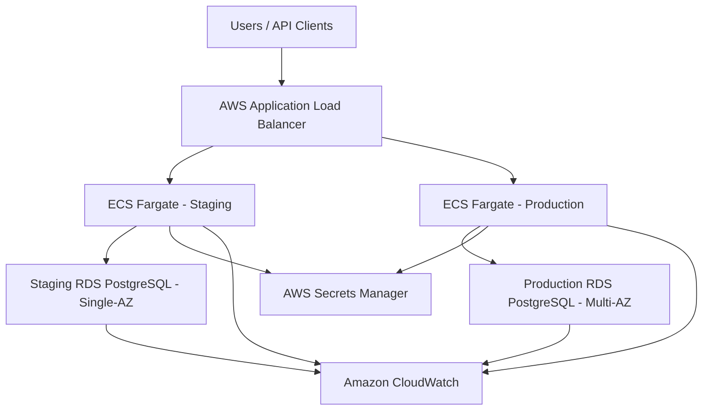
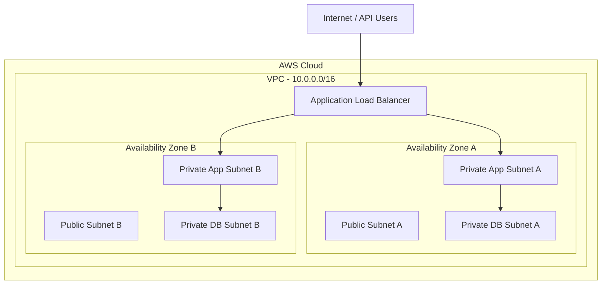
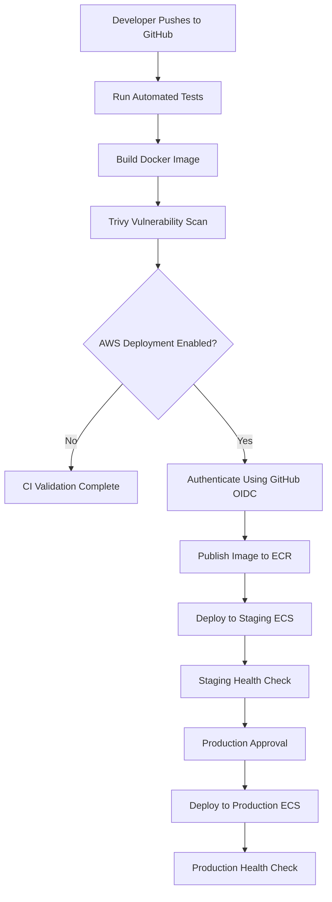
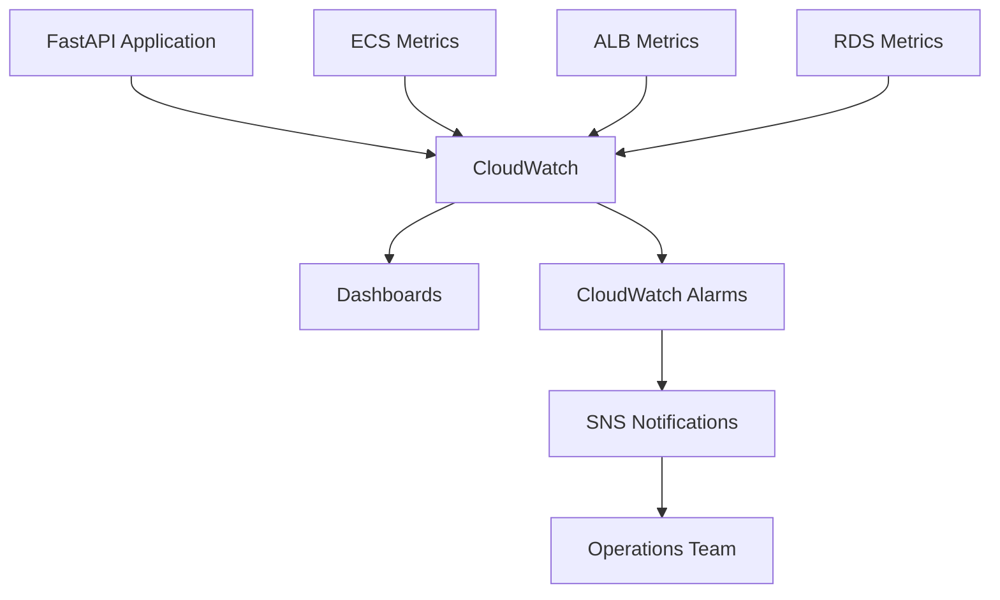
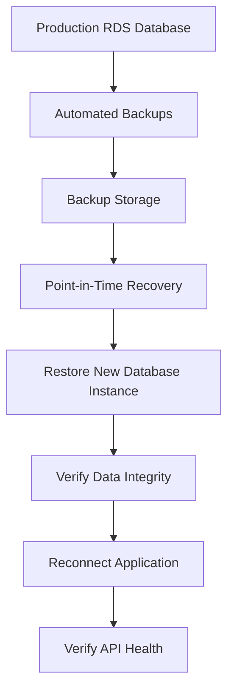

# Cloud-Native Sessions API

A containerized REST API built with Python, FastAPI, and PostgreSQL, with a DevOps-focused deployment architecture covering Docker, AWS, Terraform, CI/CD, security, monitoring, and disaster recovery.

**GitHub Repository:** [https://github.com/shiwanshu97/cloud-native-sessions-api](https://github.com/shiwanshu97/cloud-native-sessions-api)

---

## 1. Project Overview

This project demonstrates the design and implementation of a secure, scalable, and automated deployment setup for a containerized Sessions REST API.

The main focus is infrastructure automation, containerization, CI/CD, security, monitoring, logging, and disaster recovery rather than complex application development.

The application is developed using FastAPI and PostgreSQL. Docker and Docker Compose provide a consistent local development environment.

The cloud deployment architecture is designed around AWS ECS Fargate, Amazon ECR, Amazon RDS, and Terraform.

The infrastructure uses two Availability Zones to improve production availability. Staging and production have separate application services and PostgreSQL databases, with different availability and cost requirements.

No paid AWS infrastructure has been created for this assessment. The Terraform configuration has been formatted, validated, and planned without applying it.

## 2. Project Objectives

- Develop a Sessions REST API using FastAPI.
- Integrate PostgreSQL for persistent data storage.
- Containerize the API and database.
- Configure a local development environment using Docker Compose.
- Implement automated API testing using pytest.
- Provision cloud infrastructure using Terraform.
- Automate testing, image building, security scanning, and deployment.
- Implement secure secrets management and access control.
- Configure centralized logging, monitoring, and alerts.
- Document backup, recovery, and deployment rollback procedures.
- Design a production-ready Multi-AZ deployment architecture.
- Separate staging and production environments while considering infrastructure costs.

## 3. Technology Stack and Tool Selection

| Category | Technology | Purpose |
|---|---|---|
| Application | Python + FastAPI | Develop REST API |
| Database | PostgreSQL | Store session data |
| ORM | SQLAlchemy | Database operations and object mapping |
| Data validation | Pydantic | Validate API requests and responses |
| Containerization | Docker | Package application |
| Local environment | Docker Compose | Run API and database locally |
| Cloud provider | AWS | Cloud infrastructure |
| Container runtime | ECS Fargate | Run application containers |
| Container registry | Amazon ECR | Store Docker images |
| Database hosting | Amazon RDS | Managed PostgreSQL |
| Infrastructure as Code | Terraform | Provision infrastructure |
| CI/CD | GitHub Actions | Automate build and deployment |
| Security scanning | Trivy | Scan vulnerabilities |
| Monitoring | Amazon CloudWatch | Logs, metrics, and alerts |
| Secrets management | AWS Secrets Manager | Secure credentials |
| Version control | Git + GitHub | Track and manage code |
| Testing | pytest + FastAPI TestClient | Automated API testing |

### Why These Technologies?

**FastAPI:** Lightweight Python framework with automatic API documentation.

**PostgreSQL:** Reliable relational database with strong Docker and AWS integration.

**SQLAlchemy:** Provides database interaction through Python objects and SQL queries.

**Pydantic:** Validates API input and structures API responses.

**Docker:** Packages the application and dependencies into portable containers.

**Docker Compose:** Runs multiple containers together for local development and testing.

**AWS ECS Fargate:** Runs containers without requiring us to manage underlying servers.

**Terraform:** Defines reusable infrastructure configuration and supports repeatable deployments.

**GitHub Actions:** Integrates directly with GitHub and automates testing, building, scanning, and deployment.

**Trivy:** Identifies vulnerabilities in container images and dependencies.

**CloudWatch:** Centralizes logs, metrics, dashboards, and alarms.

**AWS Secrets Manager:** Stores sensitive credentials securely and supports rotation.

### Alternative Tools Considered

**Jenkins vs GitHub Actions**

Both support CI/CD automation. GitHub Actions was selected because it integrates directly with GitHub and does not require maintaining a separate Jenkins server.

**Why Not Ansible?**

Ansible is useful for configuring servers and operating systems. Since we use ECS Fargate, AWS manages the underlying infrastructure. Terraform handles infrastructure provisioning, so Ansible is not required.

**Why Not Kubernetes / EKS?**

Kubernetes provides advanced container orchestration but adds operational complexity. ECS Fargate is sufficient for this small service and requires less infrastructure management.

## 4. Application Architecture

The application is a REST API developed using FastAPI, with PostgreSQL as its persistent database.

SQLAlchemy is used to communicate with PostgreSQL. Pydantic schemas validate incoming requests and define response structures.

### Implemented API Endpoints

| Method | Endpoint | Purpose |
|---|---|---|
| GET | `/` | Welcome message |
| GET | `/health` | Health check |
| GET | `/sessions` | Retrieve all sessions |
| POST | `/sessions` | Create a session |
| GET | `/sessions/{session_id}` | Retrieve a session by ID |
| PUT | `/sessions/{session_id}` | Update a session |
| DELETE | `/sessions/{session_id}` | Delete a session |

### Application Features

- FastAPI application with automatic Swagger documentation.
- PostgreSQL database integration.
- SQLAlchemy database models.
- Pydantic request and response schemas.
- Create, read, update, and delete operations.
- Database connection management through dependency injection.
- Automatic database table creation during application startup for the current implementation.
- HTTP 404 responses when a requested session does not exist.

For a future production enhancement, database schema changes should be managed through a migration tool such as Alembic rather than relying only on automatic table creation.

### API Documentation

When the application is running locally, interactive Swagger documentation is available at:

`http://localhost:8001/docs`

Alternative API documentation:

`http://localhost:8001/redoc`

## 5. Local Development Environment

The development environment runs on macOS with an Apple Silicon M2 processor.

### Development Tools

| Tool | Purpose |
|---|---|
| macOS | Development operating system |
| Visual Studio Code | Code editor |
| Python 3.14 | Application runtime |
| Python venv | Isolated Python environment |
| Homebrew | Package management |
| Git | Version control |
| Docker Desktop | Container runtime |
| Docker Compose | Multi-container management |

### Python Virtual Environment

A Python virtual environment named `.venv` was created in the project root.

It isolates project dependencies from the system Python installation.

Activate the environment:

```bash
source .venv/bin/activate
```

Install project dependencies:

```bash
pip install -r requirements.txt
```

The installed dependencies are recorded in `requirements.txt`.

### Run the Application Locally

Start the FastAPI development server:

```bash
uvicorn app.main:app --reload
```

The application is available at:

`http://127.0.0.1:8000`

Stop the server using `Ctrl + C`.

## 6. PostgreSQL Integration

PostgreSQL is used as the persistent relational database.

The application uses SQLAlchemy to interact with the database.

### Database Structure

The current database contains a `sessions` table.

| Column | Type | Description |
|---|---|---|
| id | Integer | Primary key |
| title | String | Session title |
| description | String | Session description |

### Database Connection

The application supports two database configuration approaches:

1. `DATABASE_URL` for local Docker Compose.
2. Individual environment variables for ECS deployment.

The ECS configuration uses:

- `DB_HOST`
- `DB_PORT`
- `DB_NAME`
- `DB_USER`
- `DB_PASSWORD`

For local development outside Docker, a default localhost connection is provided in the database connection module.

When running through Docker Compose, the application connects to PostgreSQL using the internal service hostname `db`.

### Database Persistence

Docker Compose uses a named Docker volume:

`postgres_data`

This ensures database records survive container restarts and recreation, as long as the volume is retained.

The database is not exposed through a host port in the current Compose configuration.

### Cloud Database Separation

The Terraform architecture defines two separate PostgreSQL databases:

| Environment | Database | Availability |
|---|---|---|
| Staging | `sessions-api-staging-postgres` | Single-AZ |
| Production | `sessions-api-production-postgres` | Multi-AZ |

Each database has its own endpoint and AWS Secrets Manager-managed credentials.

This prevents staging and production from sharing the same database and provides better environment isolation.

## 7. Docker Implementation

The FastAPI application has been containerized using Docker.

### Dockerfile

Location:

`docker/Dockerfile`

The Dockerfile:

1. Uses the official Python 3.14 slim image.
2. Sets `/app` as the working directory.
3. Copies `requirements.txt`.
4. Installs Python dependencies.
5. Copies the application source code.
6. Exposes port 8000.
7. Starts the application using Uvicorn.

### Docker Image Build

Build the Docker image from the project root:

```bash
docker build -f docker/Dockerfile -t sessions-api:1.0 .
```

### Run the Container Independently

```bash
docker run -d --name sessions-api-container -p 8001:8000 sessions-api:1.0
```

Check the running container:

```bash
docker ps
```

Test the health endpoint:

`http://localhost:8001/health`

### Docker Ignore Configuration

Location:

`.dockerignore`

The following files and directories are excluded from the Docker build context:

- `.venv/`
- `__pycache__/`
- `.pytest_cache/`
- `.git/`
- `.DS_Store`
- Python bytecode files
- `.env` files

This reduces unnecessary files in the build context and avoids copying local environment files into the image.

## 8. Docker Compose Implementation

Docker Compose is configured to run the API and PostgreSQL database together.

Location:

`docker-compose.yml`

### Services

| Service | Container Name | Internal Port | Host Port |
|---|---|---|---|
| FastAPI | sessions-api-container | 8000 | 8001 |
| PostgreSQL | sessions-db-container | 5432 | Not exposed |

### Implemented Compose Features

- Separate API and database containers.
- PostgreSQL 16 image.
- Environment-based database configuration.
- Named volume for persistent database storage.
- PostgreSQL health check using `pg_isready`.
- API startup dependency on database health.
- Restart policy configured for both services.

### Start the Application

From the project root:

```bash
docker compose up -d --build
```

### Check Container Status

```bash
docker compose ps
```

### View Container Logs

```bash
docker compose logs
```

For API logs only:

```bash
docker compose logs sessions-api
```

For database logs only:

```bash
docker compose logs db
```

### Restart the API

```bash
docker compose restart sessions-api
```

### Stop the Application

```bash
docker compose down
```

To remove the containers and the persistent database volume:

```bash
docker compose down -v
```

**Warning:** The `-v` option deletes the PostgreSQL volume and its stored data.

### Local Testing Results

The following operations were successfully tested using the running Docker Compose environment:

- API and PostgreSQL containers started successfully.
- PostgreSQL reported a healthy container status.
- API health endpoint returned a successful response.
- Swagger documentation was accessible.
- A session was created successfully.
- Session records were retrieved successfully.
- A session was updated successfully.
- Updated records remained available after restarting the API container.

## 9. Automated Testing

Automated API tests are implemented using:

- pytest
- FastAPI TestClient
- SQLAlchemy
- SQLite
- HTTPX

Location:

`tests/test_api.py`

### Separate Test Database

The tests use a temporary SQLite database instead of the development PostgreSQL database.

This prevents automated tests from modifying actual development records.

The SQLite engine uses `StaticPool` to share the in-memory database connection.

A pytest fixture automatically drops and recreates database tables before every test, keeping tests independent.

### Test Coverage

The current test suite contains 10 tests:

| Test | Description |
|---|---|
| `test_home` | Tests the welcome endpoint |
| `test_health_check` | Tests the health endpoint |
| `test_create_session` | Tests session creation |
| `test_get_all_sessions` | Tests retrieving all sessions |
| `test_get_session_by_id` | Tests retrieving a session by ID |
| `test_update_session` | Tests updating a session |
| `test_delete_session` | Tests deleting a session |
| `test_session_not_found` | Tests retrieving a nonexistent session |
| `test_update_session_not_found` | Tests updating a nonexistent session |
| `test_delete_session_not_found` | Tests deleting a nonexistent session |

### Run Automated Tests

From the project root, with the virtual environment activated:

```bash
python3 -m pytest -v
```

### Latest Test Results

**Test execution result: 10 passed, 0 failed.**

A Starlette deprecation warning related to HTTPX remains in the current testing dependency stack. It does not prevent the tests from passing.

## 10. Git and GitHub Version Control

Git has been initialized in the project root.

### Repository Details

**Repository Name:** `cloud-native-sessions-api`

**GitHub URL:**

[https://github.com/shiwanshu97/cloud-native-sessions-api](https://github.com/shiwanshu97/cloud-native-sessions-api)

### Git Configuration Completed

- Local Git repository initialized.
- Main branch created.
- `.gitignore` configured.
- Project files staged.
- Initial commit created.
- GitHub remote configured as `origin`.
- Local main branch connected to the remote main branch.
- Initial project pushed successfully to GitHub.

### Git Commands Used

Initialize repository:

```bash
git init
```

Check repository status:

```bash
git status
```

Stage project files:

```bash
git add .
```

Create a commit:

```bash
git commit -m "Initial project setup"
```

Connect GitHub remote:

```bash
git remote add origin https://github.com/shiwanshu97/cloud-native-sessions-api.git
```

Push to GitHub:

```bash
git push -u origin main
```

### .gitignore

The `.gitignore` file excludes:

- Python virtual environments.
- Python cache files.
- pytest cache.
- Environment files and secrets.
- macOS system files.
- Terraform-generated directories.
- Terraform state files.
- Terraform variable files.

This helps prevent local configuration, temporary files, and sensitive information from being committed.

## 11. High-Level Cloud Architecture

The planned production architecture follows a containerized, cloud-based design.

### Runtime Architecture



### Request Flow

1. A user sends an HTTPS request.
2. The Application Load Balancer receives the request.
3. The load balancer forwards traffic to a healthy ECS application container.
4. FastAPI validates and processes the request.
5. The application communicates with its environment-specific PostgreSQL database.
6. PostgreSQL stores or retrieves the requested data.
7. The API returns a response to the user.
8. Application and infrastructure logs and metrics are collected in CloudWatch.

The database is not directly accessible from the public internet.

## 12. AWS Infrastructure and Network Design

The application is designed to run inside an AWS Virtual Private Cloud (VPC).

The network is divided into public and private subnets across two Availability Zones.

### VPC Architecture

The Terraform configuration uses the VPC CIDR:

`10.0.0.0/16`

Each Availability Zone contains:

- One public subnet.
- One private application subnet.
- One private database subnet.



### Network Boundaries

**Public Subnets**

- Application Load Balancer.
- Internet-facing entry point for application traffic.

**Private Application Subnets**

- ECS Fargate application containers.
- No direct public access to application tasks.

**Private Database Subnets**

- Amazon RDS PostgreSQL instances.
- No public IP addresses.
- Accept connections only from the application security group.

### Security Group Rules

| Resource | Allowed Traffic |
|---|---|
| ALB | Public HTTPS on port 443; staging HTTPS on port 8443 |
| ECS | ALB security group to port 8000 |
| RDS | ECS security group to port 5432 |

Only required network communication is permitted.

### VPC Endpoints

Terraform defines endpoints for:

- Amazon ECR API.
- Amazon ECR Docker registry.
- CloudWatch Logs.
- AWS Secrets Manager.
- Amazon S3 gateway endpoint.

These endpoints allow private ECS tasks to access the required AWS services without requiring a NAT gateway for this traffic.

### Supporting AWS Services

**Amazon ECR:** Stores versioned Docker images.

**AWS Secrets Manager:** Stores database credentials securely.

**AWS Certificate Manager:** Provides TLS certificates for HTTPS connections at the load balancer.

**AWS IAM:** Controls permissions for ECS tasks and deployment automation.

## 13. Multi-AZ Deployment and Environment Separation

High availability is an important part of the production architecture.

The design uses two Availability Zones to reduce the impact of an individual Availability Zone failure.

Staging and production have different availability and cost requirements.

### Deployment Configuration

| Component | Staging | Production |
|---|---|---|
| ECS service | Separate service | Separate service |
| Desired ECS tasks | 1 | 2 |
| Application subnets | Two AZs available | Two AZs available |
| PostgreSQL | Single-AZ | Multi-AZ |
| Database endpoint | Separate | Separate |
| Database credentials | Separate | Separate |
| Backup retention | 1 day | 7 days |
| Database deletion protection | Disabled | Enabled |
| Load balancer | Shared ALB | Shared ALB |

### Production ECS Availability

Production has two desired ECS Fargate tasks.

Both private application subnets are provided to the ECS service, allowing ECS to place tasks across the two Availability Zones.

ECS can replace failed tasks automatically, while the ALB health checks identify unhealthy application targets.

The two-task configuration improves application availability, but subnet configuration alone does not guarantee that exactly one task will always run in each Availability Zone. Actual placement should be verified after deployment.

### Production Database Availability

Production uses Amazon RDS PostgreSQL with Multi-AZ enabled:

```hcl
multi_az = true
```

RDS maintains a standby database in another Availability Zone and supports automatic failover.

Staging uses:

```hcl
multi_az = false
```

This reduces staging infrastructure costs.

### Separate Database Instances

Terraform defines two independent RDS resources:

- `aws_db_instance.staging`
- `aws_db_instance.production`

Each database has its own:

- Database endpoint.
- AWS-managed master password secret.
- ECS task definition secret reference.
- Environment-specific configuration.

Both databases use the private RDS subnet group and RDS security group.

### Why This Design?

Using a Single-AZ database for staging reduces unnecessary expenditure.

Production uses Multi-AZ RDS and two desired ECS tasks to improve resilience and availability.

The design balances production reliability with cost-conscious staging infrastructure.

## 14. Terraform Infrastructure as Code

Terraform is used to define the AWS infrastructure.

The configuration is located in:

`terraform/`

The AWS provider is configured with the default region:

`ap-south-1`

The AWS Mumbai region is selected for the deployment design.

### Terraform Resources

The configuration defines:

- VPC.
- Internet gateway.
- Public subnets.
- Private application subnets.
- Private database subnets.
- Route tables and associations.
- VPC endpoints.
- Security groups.
- RDS subnet group.
- Staging PostgreSQL instance.
- Production Multi-AZ PostgreSQL instance.
- Application Load Balancer.
- Production and staging target groups.
- HTTPS listeners.
- ACM certificate and DNS validation.
- ECR repository.
- ECS cluster.
- Staging and production task definitions.
- Staging and production ECS services.
- IAM execution and task roles.
- CloudWatch log group.

### Terraform Module Structure

The infrastructure is currently organized into a root configuration and a module:

- `terraform/main.tf` configures the AWS provider and calls the infrastructure module.
- `terraform/variables.tf` defines the AWS region.
- `terraform/modules/` contains the infrastructure resource definitions.
- `terraform/modules/variables.tf` defines shared module inputs.
- `terraform/modules/outputs.tf` exposes useful infrastructure outputs.

### Terraform Validation

The following commands were run successfully:

```bash
terraform fmt -recursive
terraform validate
```

Validation result:

```text
Success! The configuration is valid.
```

The formatting check also completed without reporting formatting issues:

```bash
terraform fmt -check -recursive
```

### Terraform Plan

The latest Terraform plan reports:

```text
Plan: 46 to add, 0 to change, 0 to destroy.
```

The plan confirms both database resources:

```text
module.network.aws_db_instance.production will be created
module.network.aws_db_instance.staging will be created
```

The plan includes the separate staging and production databases, ECS services, networking, load balancing, security groups, IAM resources, and supporting infrastructure.

**Important:** Terraform has not been applied. The 46 resources are planned only; no AWS infrastructure has been created for this assessment.

## 15. ECS Fargate and ECR Configuration

The Terraform configuration defines:

- One ECS cluster.
- One ECR repository.
- Separate staging and production task definitions.
- Separate staging and production ECS services.

### ECS Cluster

The cluster name is:

`sessions-api-cluster`

Container Insights is enabled in the cluster configuration.

### ECR Repository

The repository name is:

`sessions-api-api`

The repository uses immutable image tags and scan-on-push configuration.

### ECS Services

| Setting | Staging | Production |
|---|---|---|
| ECS service | `sessions-api-staging-service` | `sessions-api-production-service` |
| Task family | `sessions-api-staging` | `sessions-api-production` |
| Desired tasks | 1 | 2 |
| Launch type | Fargate | Fargate |
| CPU | 256 | 256 |
| Memory | 512 MiB | 512 MiB |
| Container port | 8000 | 8000 |

Both services run in private application subnets and use the ECS security group.

The Application Load Balancer forwards traffic to the corresponding target groups.

### Container Configuration

The task definitions use environment-specific database endpoints and password secrets.

The ECS execution role has permission to retrieve both database password secrets from Secrets Manager.

The application receives the database configuration through environment variables and the `DB_PASSWORD` secret reference.

## 16. CI/CD Pipeline Architecture

GitHub Actions automates application testing, Docker image building, vulnerability scanning, and conditional AWS deployment.

The workflow is located at:

`.github/workflows/ci.yml`

### Implemented CI/CD Workflow



### Pipeline Stages

1. Developer pushes code to GitHub.
2. GitHub Actions starts automatically.
3. Python dependencies are installed.
4. Automated application tests run.
5. Docker image is built.
6. Trivy scans the built image for vulnerabilities.
7. Image publishing is conditionally enabled.
8. GitHub Actions authenticates with AWS using OIDC.
9. The image is pushed to Amazon ECR.
10. The staging ECS task definition is updated and deployed.
11. A staging health check is performed.
12. Production deployment requires approval through a GitHub environment.
13. The production ECS service is updated.
14. A production health check is performed.
15. Rollback steps attempt to restore the previous ECS task definition if deployment or health verification fails.

### Trivy Security Scanning

The workflow scans the Docker image for HIGH and CRITICAL vulnerabilities.

The scan is configured to ignore unfixed vulnerabilities and fail the workflow when qualifying vulnerabilities are found.

### Secure CI/CD Authentication

GitHub Actions is designed to use OpenID Connect (OIDC) to obtain temporary AWS credentials through an IAM role.

Long-lived AWS access keys will not be stored in the repository.

### Terraform and ECS Task Definition Integration

Terraform defines the initial ECS task definitions, including:

- Execution role.
- Task role.
- Database environment variables.
- Secrets Manager references.
- CloudWatch log configuration.
- Container port configuration.

The deployment workflow retrieves the registered task definition from ECS and updates its container image.

This approach preserves the infrastructure configuration instead of maintaining separate static task definitions that could become inconsistent with Terraform.

### Deployment Configuration

The workflow uses the GitHub repository variable:

`AWS_DEPLOY_ENABLED`

When this variable is not set to `true`, the AWS publishing and deployment jobs are skipped while the CI workflow can still run.

The AWS deployment path also requires:

- An AWS IAM role ARN configured in GitHub.
- A correctly configured GitHub OIDC trust relationship.
- Provisioned ECR and ECS infrastructure.
- Registered staging and production ECS task definitions.
- A configured production GitHub environment and approval protection.

### Rollback Strategy

If deployment causes failures:

1. Detect failed health checks or deployment errors.
2. Stop the faulty release.
3. Attempt to restore the previous ECS task definition.
4. Verify application health.
5. Investigate the failed release.

### Pipeline Validation

The workflow was checked using:

```bash
actionlint .github/workflows/ci.yml
```

The latest syntax validation returned no errors.

The earlier CI and Docker build stages have also run successfully on GitHub Actions.

The latest Trivy and conditional AWS deployment workflow has been syntax-checked. Live AWS deployment, production approval, and rollback execution have not yet been tested.

## 17. Security Architecture

Security is applied across all components.

| Area | Security Control |
|---|---|
| Network | VPC and security groups |
| HTTPS | ALB and AWS Certificate Manager |
| Application access | IAM task roles |
| Database | Private subnets |
| Credentials | AWS Secrets Manager |
| CI/CD authentication | GitHub OIDC |
| Image security | Trivy |
| Source control | GitHub repository protections |
| Logging | CloudWatch |

### Network Security

The security groups enforce the following rules:

- ALB accepts public HTTPS traffic on port 443.
- Staging listener accepts HTTPS traffic on port 8443.
- ECS tasks accept application traffic on port 8000 only from the ALB security group.
- Both RDS databases accept PostgreSQL traffic on port 5432 only from the ECS security group.
- RDS instances are not publicly accessible.

Staging access on port 8443 is currently designed to be public. It should be restricted or protected with authentication before a real production deployment.

### IAM Roles

Two important ECS roles are configured in Terraform.

**Task execution role:** Allows ECS to pull images from ECR, retrieve startup secrets, and publish logs.

**Task role:** Assigned to the running application and kept separate from the execution role so application permissions can be controlled independently.

### Secrets Management

RDS manages the database master credentials through AWS Secrets Manager.

Staging and production use separate managed database password secrets.

The ECS task definitions reference the appropriate secret for each environment.

Database passwords are not embedded directly in the application source or Docker image.

### Secret Rotation

If a secret is exposed:

1. Revoke or disable the compromised credential.
2. Generate a replacement.
3. Update AWS Secrets Manager.
4. Update affected application connections.
5. Verify the service.
6. Investigate the exposure and review repository history.

## 18. SSL/TLS and HTTPS

AWS Certificate Manager is configured to request a certificate for:

`api.shiwanshu.site`

DNS validation is used.

The domain is hosted through Cloudflare.

The required ACM DNS validation record must be added to Cloudflare before the certificate can be validated.

The Application Load Balancer has:

- Production HTTPS listener on port 443.
- Staging HTTPS listener on port 8443.

Both listeners are configured to use the ACM certificate.

The certificate and DNS validation resources are defined in Terraform but have not been provisioned or validated against AWS.

## 19. Monitoring and Logging Architecture

Amazon CloudWatch is used for centralized monitoring.

The Terraform configuration creates a CloudWatch log group:

`/ecs/sessions-api`

Container logs are configured through the ECS task definitions.

### Monitoring Flow



### Metrics to Monitor

| Component | Metrics |
|---|---|
| ALB | HTTP 5xx errors, request count, response time |
| ECS | CPU utilization, memory utilization, running task count |
| RDS | CPU utilization, database connections, free storage |
| Application | Health endpoint availability and application errors |

### Planned Alerts

**Alert 1: High 5xx Errors**

Trigger an alert when the load balancer's 5xx errors exceed an agreed threshold.

**Alert 2: High CPU Utilization**

Trigger an alert when ECS CPU utilization remains above 80% for five minutes.

Alerts can be delivered through Amazon SNS.

The CloudWatch log group and ECS log configuration are defined in Terraform. The full monitoring alarms, dashboards, SNS notifications, and live alert behaviour remain to be implemented and tested.

## 20. Backup and Disaster Recovery

Amazon RDS automated backups are configured in the Terraform design.

### Backup Configuration

| Environment | Backup Retention | Multi-AZ |
|---|---|---|
| Staging | 1 day | No |
| Production | 7 days | Yes |

Production also has deletion protection enabled.

### Database Recovery Flow



### Recovery Procedure

1. Identify and investigate database failure.
2. Check RDS status and CloudWatch metrics.
3. Determine whether automatic Multi-AZ failover has occurred.
4. Identify the latest suitable backup or recovery point.
5. Restore the database if required.
6. Verify tables, records, and data integrity.
7. Update application database connectivity if necessary.
8. Test application endpoints.
9. Resume normal operations.

### Recovery Objectives

**RPO (Recovery Point Objective):** The maximum acceptable amount of data loss measured in time.

**RTO (Recovery Time Objective):** The maximum acceptable time to restore service.

The proposed production recovery targets are:

- RPO: Up to 5 minutes, subject to the available recovery mechanism and backup configuration.
- RTO: Within 1 hour, subject to recovery testing and AWS service availability.

These are proposed assessment targets, not measured guarantees. Multi-AZ failover and backup restoration should be tested before relying on these objectives in production.

## 21. Operational Incident Scenarios

### Scenario 1: Deployment Secret Exposed

- Revoke the exposed secret immediately.
- Rotate the affected credentials.
- Remove the secret from repository files and Git history where appropriate.
- Update Secrets Manager.
- Verify the application.
- Investigate the incident and prevent recurrence.

### Scenario 2: Sudden Traffic Increase

- Check ALB request count and response latency.
- Check ECS CPU and memory utilization.
- Check database CPU and connections.
- Scale ECS tasks if required.
- Assess whether database scaling is required.
- Review cost impact from additional tasks, database resources, NAT, and data transfer.

### Scenario 3: Database Unavailable

- Check RDS status and CloudWatch metrics.
- Investigate connectivity and database errors.
- Check recent database changes.
- Check whether Multi-AZ failover has occurred.
- Restore from a suitable backup if necessary.
- Verify database integrity.
- Reconnect the application.
- Verify application health.

## 22. Project Directory Structure

Current project structure:

```text
cloud-native-sessions-api/
│
├── app/
│   ├── __init__.py
│   ├── main.py
│   ├── database/
│   │   ├── __init__.py
│   │   ├── connection.py
│   │   └── models.py
│   └── schemas/
│       ├── __init__.py
│       └── session.py
│
├── tests/
│   └── test_api.py
│
├── docker/
│   └── Dockerfile
│
├── terraform/
│   ├── main.tf
│   ├── variables.tf
│   ├── .terraform.lock.hcl
│   └── modules/
│       ├── network.tf
│       ├── variables.tf
│       ├── outputs.tf
│       ├── security.tf
│       ├── database.tf
│       ├── load_balancer.tf
│       ├── certificate.tf
│       ├── ecs.tf
│       └── ecs_service.tf
│
├── .github/
│   └── workflows/
│       └── ci.yml
│
├── docs/
│   └── Ahoum Assignment DevOps Exp.pdf
│
├── docker-compose.yml
├── requirements.txt
├── .dockerignore
├── .gitignore
└── README.md
```

### Additional Documentation Planned

The following operational documents can be added as the project is finalized:

```text
docs/
├── architecture.md
├── deployment.md
├── rollback.md
├── secret-rotation.md
└── database-recovery.md
```

## 23. Cost Considerations

No paid AWS resources will be created solely for this assessment.

The project prioritizes:

- Local Docker demonstrations.
- Terraform configuration and plan output.
- Documented cloud deployment steps.
- Redacted pipeline and monitoring evidence.

The infrastructure design uses cost-conscious choices:

- ECS Fargate instead of operating an EKS cluster.
- One ECS task for staging.
- Two desired ECS tasks for production.
- Single-AZ RDS for staging.
- Multi-AZ RDS for production.
- VPC endpoints to avoid requiring a NAT gateway for the supported AWS service traffic.

Potential AWS costs include:

- ECS Fargate compute.
- Application Load Balancer.
- Amazon RDS.
- NAT Gateway, if required for additional outbound traffic.
- ECR image storage.
- CloudWatch logs and alarms.
- Secrets Manager.
- Interface VPC endpoints.
- Data transfer.

Multi-AZ production RDS, two production Fargate tasks, and interface VPC endpoints will incur additional charges if deployed.

The Terraform plan does not represent actual running infrastructure or actual AWS costs.

## 24. Current Project Status

### Completed and Tested Locally

- [x] Project folder and initial structure created.
- [x] Development tools installed and configured.
- [x] Python virtual environment created.
- [x] FastAPI application implemented.
- [x] PostgreSQL integration completed.
- [x] SQLAlchemy database models implemented.
- [x] Pydantic request and response schemas implemented.
- [x] CRUD API endpoints implemented.
- [x] Dockerfile created.
- [x] `.dockerignore` created.
- [x] Docker image built successfully.
- [x] Docker container tested locally.
- [x] Docker Compose configured for API and PostgreSQL.
- [x] PostgreSQL persistent volume configured.
- [x] PostgreSQL health check configured.
- [x] API and database containers started successfully.
- [x] API endpoints tested through Swagger.
- [x] Database persistence verified after API container restart.
- [x] Automated tests implemented using pytest.
- [x] Separate SQLite test database configured.
- [x] Test database cleanup fixture implemented.
- [x] All 10 automated tests passing.
- [x] Git initialized and configured.
- [x] `.gitignore` created.
- [x] Initial Git commit created.
- [x] GitHub repository created.
- [x] Local Git repository connected to GitHub.
- [x] Initial project pushed to GitHub main branch.
- [x] README updated with implementation and infrastructure documentation.

### Implemented or Configured and Validated

- [x] GitHub Actions CI workflow.
- [x] Automated test execution in GitHub Actions.
- [x] Docker image build in GitHub Actions.
- [x] Trivy image vulnerability scanning configuration.
- [x] Conditional ECR publishing and ECS deployment workflow.
- [x] GitHub Actions workflow syntax checked with actionlint.
- [x] Terraform AWS provider and module configuration.
- [x] AWS VPC and networking configuration.
- [x] Two Availability Zones.
- [x] Public and private network segmentation.
- [x] VPC endpoints.
- [x] Security groups.
- [x] Application Load Balancer.
- [x] ACM certificate request and DNS validation configuration.
- [x] ECR repository configuration.
- [x] ECS cluster and Fargate task definitions.
- [x] Separate staging and production ECS services.
- [x] Staging configured for one desired ECS task.
- [x] Production configured for two desired ECS tasks.
- [x] Separate staging Single-AZ database.
- [x] Separate production Multi-AZ database.
- [x] Separate database secrets and endpoints.
- [x] CloudWatch log group and ECS log configuration.
- [x] Terraform outputs updated for both databases.
- [x] Terraform formatting check passed.
- [x] Terraform validation passed.
- [x] Terraform plan generated successfully.
- [x] Terraform plan confirms 46 resources to add, 0 to change, and 0 to destroy.

### Remaining Before a Real AWS Deployment

- [ ] Configure and verify the GitHub OIDC IAM provider and deployment role.
- [ ] Configure GitHub repository variables and production environment approval.
- [ ] Complete DNS validation for the ACM certificate.
- [ ] Prepare and publish the initial ECR image before starting ECS services.
- [ ] Provision infrastructure when deployment is authorised.
- [ ] Deploy staging and verify the health endpoint.
- [ ] Deploy production and verify both ECS tasks and database connectivity.
- [ ] Verify actual ECS task placement across Availability Zones.
- [ ] Verify Multi-AZ database failover and backup recovery.
- [ ] Configure and test CloudWatch alarms, dashboards, and notifications.
- [ ] Perform deployment and rollback testing.
- [ ] Complete operational runbooks and assessment evidence.

**Important:** The AWS infrastructure remains unprovisioned. Terraform validation and planning do not create AWS resources. No `terraform apply` has been performed for this assessment.

## 25. Project Philosophy

This project follows a practical DevOps implementation approach:

1. Build a working application.
2. Containerize the application and its dependencies.
3. Validate the application locally.
4. Automate testing and release workflows.
5. Provision infrastructure through code.
6. Apply security and access controls.
7. Design high availability across Availability Zones.
8. Monitor application and infrastructure health.
9. Document recovery and operational procedures.
10. Balance reliability with infrastructure costs.

The goal is to demonstrate a complete, understandable, secure, and reproducible deployment lifecycle while avoiding unnecessary cloud expenditure.