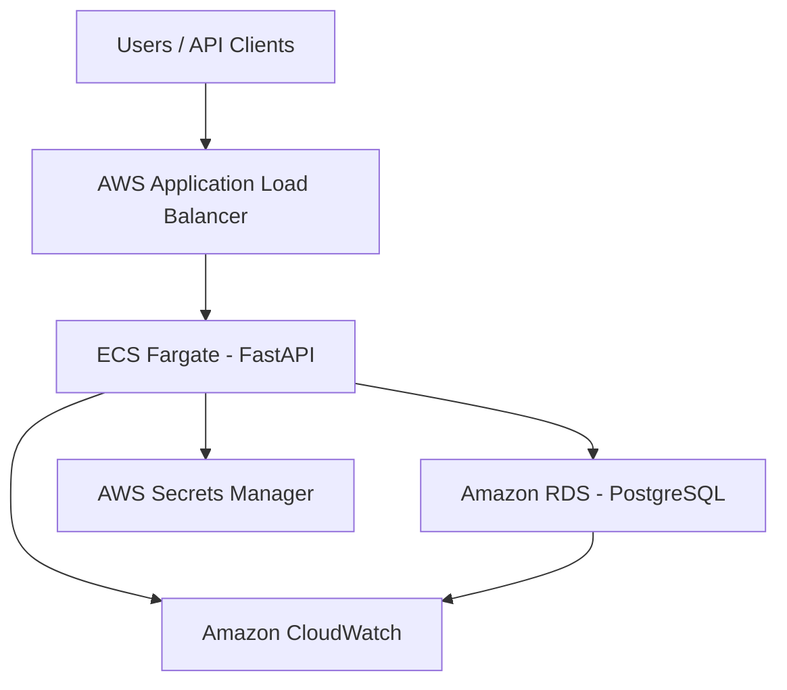
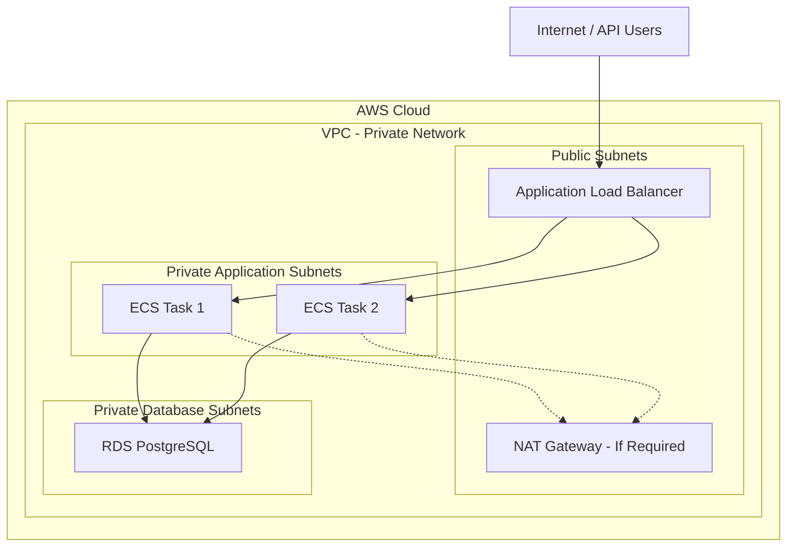
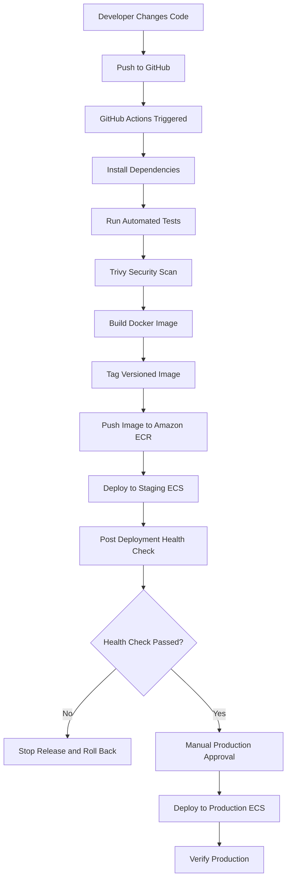
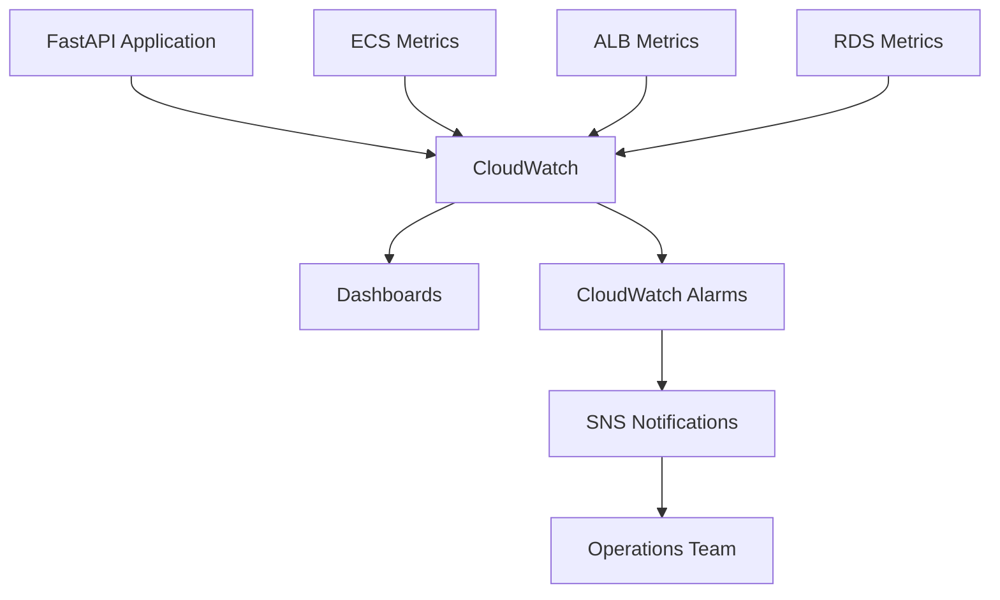
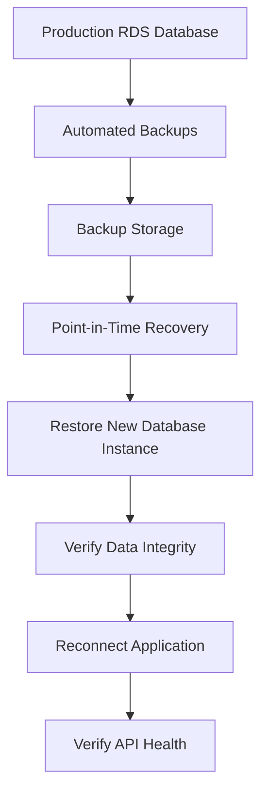

# Cloud-Native Sessions API

A containerized REST API built with Python, FastAPI, and PostgreSQL, with a DevOps-focused deployment architecture covering Docker, AWS, Terraform, CI/CD, security, monitoring, and disaster recovery.

**GitHub Repository:** https://github.com/shiwanshu97/cloud-native-sessions-api

---

## 1. Project Overview

This project demonstrates the design and implementation of a secure, scalable, and automated deployment setup for a containerized Sessions REST API.

The main focus is infrastructure automation, containerization, CI/CD, security, monitoring, logging, and disaster recovery rather than complex application development.

The application is developed using FastAPI and PostgreSQL. Docker and Docker Compose provide a consistent local development environment.

The planned cloud deployment architecture uses AWS ECS Fargate, Amazon ECR, Amazon RDS, and Terraform.

## 2. Project Objectives

- Develop a Sessions REST API using FastAPI.
- Integrate PostgreSQL for persistent data storage.
- Containerize the API and database.
- Configure a local development environment using Docker Compose.
- Implement automated API testing using pytest.
- Provision cloud infrastructure using Terraform.
- Automate testing, image building, security scanning, and deployment.
- Implement secure secrets management and access control.
- Configure centralized logging, monitoring, and alerts.
- Document backup, recovery, and deployment rollback procedures.

## 3. Technology Stack and Tool Selection

| Category | Technology | Purpose |
|---|---|---|
| Application | Python + FastAPI | Develop REST API |
| Database | PostgreSQL | Store session data |
| ORM | SQLAlchemy | Database operations and object mapping |
| Data validation | Pydantic | Validate API requests and responses |
| Containerization | Docker | Package application |
| Local environment | Docker Compose | Run API and database locally |
| Cloud provider | AWS | Cloud infrastructure |
| Container runtime | ECS Fargate | Run application containers |
| Container registry | Amazon ECR | Store Docker images |
| Database hosting | Amazon RDS | Managed PostgreSQL |
| Infrastructure as Code | Terraform | Provision infrastructure |
| CI/CD | GitHub Actions | Automate build and deployment |
| Security scanning | Trivy | Scan vulnerabilities |
| Monitoring | Amazon CloudWatch | Logs, metrics, and alerts |
| Secrets management | AWS Secrets Manager | Secure credentials |
| Version control | Git + GitHub | Track and manage code |
| Testing | pytest + FastAPI TestClient | Automated API testing |

### Why These Technologies?

**FastAPI:** Lightweight Python framework with automatic API documentation.

**PostgreSQL:** Reliable relational database with strong Docker and AWS integration.

**SQLAlchemy:** Provides database interaction through Python objects and SQL queries.

**Pydantic:** Validates API input and structures API responses.

**Docker:** Packages the application and dependencies into portable containers.

**Docker Compose:** Runs multiple containers together for local development and testing.

**AWS ECS Fargate:** Runs containers without requiring us to manage underlying servers.

**Terraform:** Defines reusable infrastructure configuration and supports repeatable deployments.

**GitHub Actions:** Integrates directly with GitHub and automates testing, building, scanning, and deployment.

**Trivy:** Identifies vulnerabilities in container images and dependencies.

**CloudWatch:** Centralizes logs, metrics, dashboards, and alarms.

**AWS Secrets Manager:** Stores sensitive credentials securely and supports rotation.

### Alternative Tools Considered

**Jenkins vs GitHub Actions**

Both support CI/CD automation. GitHub Actions was selected because it integrates directly with GitHub and does not require maintaining a separate Jenkins server.

**Why Not Ansible?**

Ansible is useful for configuring servers and operating systems. Since we use ECS Fargate, AWS manages the underlying infrastructure. Terraform handles infrastructure provisioning, so Ansible is not required.

**Why Not Kubernetes / EKS?**

Kubernetes provides advanced container orchestration but adds operational complexity. ECS Fargate is sufficient for this small service and requires less infrastructure management.

## 4. Application Architecture

The application is a REST API developed using FastAPI, with PostgreSQL as its persistent database.

SQLAlchemy is used to communicate with PostgreSQL. Pydantic schemas validate incoming requests and define response structures.

### Implemented API Endpoints

| Method | Endpoint | Purpose |
|---|---|---|
| GET | `/` | Welcome message |
| GET | `/health` | Health check |
| GET | `/sessions` | Retrieve all sessions |
| POST | `/sessions` | Create a session |
| GET | `/sessions/{session_id}` | Retrieve a session by ID |
| PUT | `/sessions/{session_id}` | Update a session |
| DELETE | `/sessions/{session_id}` | Delete a session |

### Application Features

- FastAPI application with automatic Swagger documentation.
- PostgreSQL database integration.
- SQLAlchemy database models.
- Pydantic request and response schemas.
- Create, read, update, and delete operations.
- Database connection management through dependency injection.
- Automatic database table creation during application startup for the current local implementation.
- HTTP 404 responses when a requested session does not exist.

### API Documentation

When the application is running locally, interactive Swagger documentation is available at:

`http://localhost:8001/docs`

Alternative API documentation:

`http://localhost:8001/redoc`

## 5. Local Development Environment

The development environment runs on macOS with an Apple Silicon M2 processor.

### Development Tools

| Tool | Purpose |
|---|---|
| macOS | Development operating system |
| Visual Studio Code | Code editor |
| Python 3.14 | Application runtime |
| Python venv | Isolated Python environment |
| Homebrew | Package management |
| Git | Version control |
| Docker Desktop | Container runtime |
| Docker Compose | Multi-container management |

### Python Virtual Environment

A Python virtual environment named `.venv` was created in the project root.

It isolates project dependencies from the system Python installation.

Activate the environment:

```bash
source .venv/bin/activate
```

Install project dependencies:

```bash
pip install -r requirements.txt
```

The installed dependencies are recorded in `requirements.txt`.

### Run the Application Locally

Start the FastAPI development server:

```bash
uvicorn app.main:app --reload
```

The application is available at:

`http://127.0.0.1:8000`

Stop the server using `Ctrl + C`.

## 6. PostgreSQL Integration

PostgreSQL is used as the persistent relational database.

The application uses SQLAlchemy to interact with the database.

### Database Structure

The current database contains a `sessions` table.

| Column | Type | Description |
|---|---|---|
| id | Integer | Primary key |
| title | String | Session title |
| description | String | Session description |

### Database Connection

The application reads its database connection string from the `DATABASE_URL` environment variable.

For local development outside Docker, a default localhost connection is provided in the database connection module.

When running through Docker Compose, the application connects to the PostgreSQL service using the internal service hostname `db`.

### Database Persistence

Docker Compose uses a named Docker volume:

`postgres_data`

This ensures database records survive container restarts and recreation, as long as the volume is retained.

The database is not exposed through a host port in the current Compose configuration.

## 7. Docker Implementation

The FastAPI application has been containerized using Docker.

### Dockerfile

Location:

`docker/Dockerfile`

The Dockerfile:

1. Uses the official Python 3.14 slim image.
2. Sets `/app` as the working directory.
3. Copies `requirements.txt`.
4. Installs Python dependencies.
5. Copies the application source code.
6. Exposes port 8000.
7. Starts the application using Uvicorn.

### Docker Image Build

Build the Docker image from the project root:

```bash
docker build -f docker/Dockerfile -t sessions-api:1.0 .
```

### Run the Container Independently

```bash
docker run -d --name sessions-api-container -p 8001:8000 sessions-api:1.0
```

Check the running container:

```bash
docker ps
```

Test the health endpoint:

`http://localhost:8001/health`

### Docker Ignore Configuration

Location:

`.dockerignore`

The following files and directories are excluded from the Docker build context:

- `.venv/`
- `__pycache__/`
- `.pytest_cache/`
- `.git/`
- `.DS_Store`
- Python bytecode files
- `.env` files

This reduces unnecessary files in the build context and avoids copying local environment files into the image.

## 8. Docker Compose Implementation

Docker Compose is configured to run the API and PostgreSQL database together.

Location:

`docker-compose.yml`

### Services

| Service | Container Name | Internal Port | Host Port |
|---|---|---|---|
| FastAPI | sessions-api-container | 8000 | 8001 |
| PostgreSQL | sessions-db-container | 5432 | Not exposed |

### Implemented Compose Features

- Separate API and database containers.
- PostgreSQL 16 image.
- Environment-based database configuration.
- Named volume for persistent database storage.
- PostgreSQL health check using `pg_isready`.
- API startup dependency on database health.
- Restart policy configured for both services.

### Start the Application

From the project root:

```bash
docker compose up -d --build
```

### Check Container Status

```bash
docker compose ps
```

### View Container Logs

```bash
docker compose logs
```

For API logs only:

```bash
docker compose logs sessions-api
```

For database logs only:

```bash
docker compose logs db
```

### Restart the API

```bash
docker compose restart sessions-api
```

### Stop the Application

```bash
docker compose down
```

To remove the containers and the persistent database volume:

```bash
docker compose down -v
```

**Warning:** The `-v` option deletes the PostgreSQL volume and its stored data.

### Local Testing Results

The following operations were successfully tested using the running Docker Compose environment:

- API and PostgreSQL containers started successfully.
- PostgreSQL reported a healthy container status.
- API health endpoint returned a successful response.
- Swagger documentation was accessible.
- A session was created successfully.
- Session records were retrieved successfully.
- A session was updated successfully.
- Updated records remained available after restarting the API container.

## 9. Automated Testing

Automated API tests are implemented using:

- pytest
- FastAPI TestClient
- SQLAlchemy
- SQLite
- HTTPX

Location:

`tests/test_api.py`

### Separate Test Database

The tests use a temporary SQLite database instead of the development PostgreSQL database.

This prevents automated tests from modifying actual development records.

The SQLite engine uses `StaticPool` to share the in-memory database connection.

A pytest fixture automatically drops and recreates database tables before every test, keeping tests independent.

### Test Coverage

The current test suite contains 10 tests:

| Test | Description |
|---|---|
| `test_home` | Tests the welcome endpoint |
| `test_health_check` | Tests the health endpoint |
| `test_create_session` | Tests session creation |
| `test_get_all_sessions` | Tests retrieving all sessions |
| `test_get_session_by_id` | Tests retrieving a session by ID |
| `test_update_session` | Tests updating a session |
| `test_delete_session` | Tests deleting a session |
| `test_session_not_found` | Tests retrieving a nonexistent session |
| `test_update_session_not_found` | Tests updating a nonexistent session |
| `test_delete_session_not_found` | Tests deleting a nonexistent session |

### Run Automated Tests

From the project root, with the virtual environment activated:

```bash
python3 -m pytest -v
```

### Latest Test Results

**Test execution result: 10 passed, 0 failed.**

The tests have been executed successfully.

A Starlette deprecation warning related to HTTPX remains in the current testing dependency stack. It does not prevent the tests from passing.

## 10. Git and GitHub Version Control

Git has been initialized in the project root.

### Repository Details

**Repository Name:** `cloud-native-sessions-api`

**GitHub URL:**

https://github.com/shiwanshu97/cloud-native-sessions-api

### Git Configuration Completed

- Local Git repository initialized.
- Main branch created.
- `.gitignore` configured.
- Project files staged.
- Initial commit created.
- GitHub remote configured as `origin`.
- Local main branch connected to the remote main branch.
- Initial project pushed successfully to GitHub.

### Initial Commit

Commit message:

`Initial project setup`

### Git Commands Used

Initialize repository:

```bash
git init
```

Check repository status:

```bash
git status
```

Stage project files:

```bash
git add .
```

Create a commit:

```bash
git commit -m "Initial project setup"
```

Connect GitHub remote:

```bash
git remote add origin https://github.com/shiwanshu97/cloud-native-sessions-api.git
```

Push to GitHub:

```bash
git push -u origin main
```

### .gitignore

The `.gitignore` file excludes:

- Python virtual environments.
- Python cache files.
- pytest cache.
- Environment files and secrets.
- macOS system files.
- Terraform-generated directories.
- Terraform state files.
- Terraform variable files.

This helps prevent local configuration, temporary files, and sensitive information from being committed.

## 11. High-Level Cloud Architecture

The planned production architecture follows a containerized, cloud-based design.

### Runtime Architecture



### Request Flow

1. A user sends an HTTP request over HTTPS.
2. The Application Load Balancer receives the request.
3. The load balancer forwards traffic to a healthy ECS application container.
4. FastAPI validates and processes the request.
5. The application communicates with PostgreSQL.
6. PostgreSQL stores or retrieves the requested data.
7. The API returns a response to the user.
8. Application and infrastructure logs and metrics are collected in CloudWatch.

The database is not directly accessible from the public internet.

## 12. AWS Infrastructure and Network Design

The application is planned to run inside an AWS Virtual Private Cloud (VPC).

The network will be divided into public and private subnets across two Availability Zones.

### VPC Architecture



### Network Boundaries

**Public Subnets**

- Application Load Balancer.
- NAT Gateway, if required.

**Private Application Subnets**

- ECS Fargate application containers.
- No direct public access to application tasks.

**Private Database Subnets**

- Amazon RDS PostgreSQL.
- No public IP address.
- Accepts connections only from the application security group.

### Security Group Rules

| Resource | Allowed Traffic |
|---|---|
| ALB | Internet to port 443 |
| ECS | ALB security group to port 8000 |
| RDS | ECS security group to port 5432 |

Only required network communication is permitted.

### Supporting AWS Services

**Amazon ECR:** Stores versioned Docker images such as `sessions-api:v1` and `sessions-api:v2`.

**AWS Secrets Manager:** Stores database credentials securely.

**AWS Certificate Manager:** Provides TLS certificates for HTTPS connections at the load balancer.

**AWS IAM:** Controls permissions for ECS tasks and deployment automation.

## 13. CI/CD Pipeline Architecture

GitHub Actions will automate the application release process.

### Planned CI/CD Workflow



### Planned Pipeline Stages

1. Developer pushes code to GitHub.
2. GitHub Actions starts automatically.
3. Dependencies are installed.
4. Automated application tests run.
5. Trivy scans for vulnerabilities.
6. Docker image is built and versioned.
7. Image is pushed to Amazon ECR.
8. Staging ECS service is updated.
9. Post-deployment health checks run.
10. Production deployment requires manual approval.
11. Production is deployed and verified.

### Secure CI/CD Authentication

GitHub Actions will use OpenID Connect (OIDC) to obtain temporary AWS credentials through an IAM role.

Long-lived AWS access keys will not be stored in the repository.

### Rollback Strategy

If deployment causes failures:

1. Detect failed health checks or increased 5xx errors.
2. Stop the faulty release.
3. Restore the previous known-good container image.
4. Verify application health.
5. Investigate the failed release.

## 14. Environment Separation

The project will use three environments.

### Development

- Runs locally on a developer's Mac.
- Uses Docker and Docker Compose.
- Uses a local PostgreSQL database.
- Used for development and testing.

### Staging

- Runs on AWS ECS Fargate.
- Uses a separate staging configuration and database.
- Used to validate releases before production.

### Production

- Runs on a separate ECS service.
- Uses production-specific database credentials.
- Uses separate secrets and configuration.
- Serves real application traffic.

Staging and production will not share credentials or application secrets.

## 15. Security Architecture

Security will be applied across all components.

| Area | Security Control |
|---|---|
| Network | VPC and security groups |
| HTTPS | ALB and AWS Certificate Manager |
| Application access | IAM task roles |
| Database | Private subnets |
| Credentials | AWS Secrets Manager |
| CI/CD authentication | GitHub OIDC |
| Image security | Trivy |
| Source control | GitHub repository protections |
| Logging | CloudWatch |

### IAM Roles

Two important ECS roles will be configured:

**Task execution role:** Allows ECS to pull images from ECR, retrieve startup secrets where configured, and publish logs.

**Task role:** Gives the running application only the permissions it needs.

The principle of least privilege will be followed.

### Secret Rotation

If a secret is exposed:

1. Revoke or disable the compromised credential.
2. Generate a replacement.
3. Update AWS Secrets Manager.
4. Update affected application connections.
5. Verify the service.
6. Investigate the exposure and review repository history.

## 16. Monitoring and Logging Architecture

Amazon CloudWatch will be used for centralized monitoring.

### Monitoring Flow



### Metrics to Monitor

- HTTP 5xx errors.
- ECS CPU utilization.
- ECS memory utilization.
- Request count.
- Database connections.
- Database CPU utilization.
- Database storage capacity.

### Planned Alerts

**Alert 1: High 5xx Errors**

Trigger an alert when the load balancer's 5xx errors exceed an agreed threshold.

**Alert 2: High CPU Utilization**

Trigger an alert when ECS CPU utilization remains above 80% for five minutes.

Alerts will be delivered through Amazon SNS.

## 17. Backup and Disaster Recovery

Amazon RDS automated backups will be configured for the production database.

### Database Recovery Flow



### Recovery Procedure

1. Identify and investigate database failure.
2. Determine the latest suitable backup or recovery point.
3. Restore the database.
4. Verify tables, records, and data integrity.
5. Update application database connectivity if necessary.
6. Test application endpoints.
7. Resume normal operations.

### Recovery Objectives

**RPO (Recovery Point Objective):** The maximum acceptable amount of data loss measured in time.

**RTO (Recovery Time Objective):** The maximum acceptable time to restore service.

Specific RPO and RTO targets will be defined and tested as part of the recovery exercise.

## 18. Operational Incident Scenarios

### Scenario 1: Deployment Secret Exposed

- Revoke the exposed secret immediately.
- Rotate the affected credentials.
- Remove the secret from repository files and Git history where appropriate.
- Update Secrets Manager.
- Verify the application.
- Investigate the incident and prevent recurrence.

### Scenario 2: Sudden Traffic Increase

- Check ALB request count and response latency.
- Check ECS CPU and memory utilization.
- Check database CPU and connections.
- Scale ECS tasks using service autoscaling.
- Assess whether database scaling is required.
- Review cost impact from additional tasks, database resources, NAT, and data transfer.

### Scenario 3: Database Unavailable

- Check RDS status and CloudWatch metrics.
- Investigate connectivity and database errors.
- Check recent database changes.
- Restore from a suitable backup if necessary.
- Verify database integrity.
- Reconnect the application.
- Verify application health.

## 19. Project Directory Structure

Current project structure:

```text
cloud-native-sessions-api/
│
├── app/
│   ├── __init__.py
│   │
│   ├── database/
│   │   ├── __init__.py
│   │   ├── connection.py
│   │   └── models.py
│   │
│   ├── schemas/
│   │   ├── __init__.py
│   │   └── session.py
│   │
│   └── main.py
│
├── tests/
│   └── test_api.py
│
├── docker/
│   └── Dockerfile
│
├── docs/
│   └── Ahoum Assignment DevOps Exp.pdf
│
├── docker-compose.yml
├── requirements.txt
├── .dockerignore
├── .gitignore
└── README.md
```

### Planned Future Directories

The following directories and files will be added as the project progresses:

```text
terraform/
├── modules/
└── environments/

docs/
├── architecture.md
├── deployment.md
├── rollback.md
├── secret-rotation.md
└── database-recovery.md

.github/
└── workflows/
    └── ci-cd.yml
```

## 20. Cost Considerations

No paid AWS resources will be created solely for this assessment.

The project will prioritize:

- Local Docker demonstrations.
- Terraform configuration and plan output.
- Documented cloud deployment steps.
- Redacted pipeline and monitoring evidence.

Any cloud deployment will be optional and subject to cost review.

Potential AWS costs include:

- ECS Fargate compute.
- Application Load Balancer.
- Amazon RDS.
- NAT Gateway.
- ECR image storage.
- CloudWatch logs and alarms.
- Secrets Manager.
- Data transfer.

Cost optimization will be considered when designing the infrastructure.

## 21. Current Project Status

### Completed

- [x] Project folder and initial structure created.
- [x] Development tools installed and configured.
- [x] Python virtual environment created.
- [x] FastAPI application implemented.
- [x] PostgreSQL integration completed.
- [x] SQLAlchemy database models implemented.
- [x] Pydantic request and response schemas implemented.
- [x] CRUD API endpoints implemented.
- [x] Dockerfile created.
- [x] `.dockerignore` created.
- [x] Docker image built successfully.
- [x] Docker container tested locally.
- [x] Docker Compose configured for API and PostgreSQL.
- [x] PostgreSQL persistent volume configured.
- [x] PostgreSQL health check configured.
- [x] API and database containers started successfully.
- [x] API endpoints tested through Swagger.
- [x] Database persistence verified after API container restart.
- [x] Automated tests implemented using pytest.
- [x] Separate SQLite test database configured.
- [x] Test database cleanup fixture implemented.
- [x] All 10 automated tests passing.
- [x] Pydantic deprecation warning fixed.
- [x] Git initialized and configured.
- [x] `.gitignore` created.
- [x] Initial Git commit created.
- [x] GitHub repository created.
- [x] Local Git repository connected to GitHub.
- [x] Initial project pushed to GitHub main branch.

### Planned / In Progress

- [ ] Final README review and update.
- [ ] GitHub Actions CI workflow.
- [ ] Automated Docker image build pipeline.
- [ ] Trivy security scanning.
- [ ] Terraform infrastructure implementation.
- [ ] AWS VPC and networking configuration.
- [ ] ECS Fargate deployment configuration.
- [ ] Amazon ECR integration.
- [ ] Amazon RDS configuration.
- [ ] GitHub OIDC and AWS IAM integration.
- [ ] AWS Secrets Manager integration.
- [ ] Staging and production environment configuration.
- [ ] Deployment health checks and rollback automation.
- [ ] CloudWatch monitoring and alerting.
- [ ] Database backup and recovery implementation.
- [ ] Operational runbooks.
- [ ] Final testing and assessment evidence.

---

## 22. Project Philosophy

This project follows a practical DevOps implementation approach:

1. Build a working application.
2. Containerize the application and its dependencies.
3. Validate the application locally.
4. Automate testing and release workflows.
5. Provision infrastructure through code.
6. Apply security and access controls.
7. Monitor application and infrastructure health.
8. Document recovery and operational procedures.

The goal is to demonstrate a complete, understandable, and reproducible deployment lifecycle while avoiding unnecessary cloud expenditure.