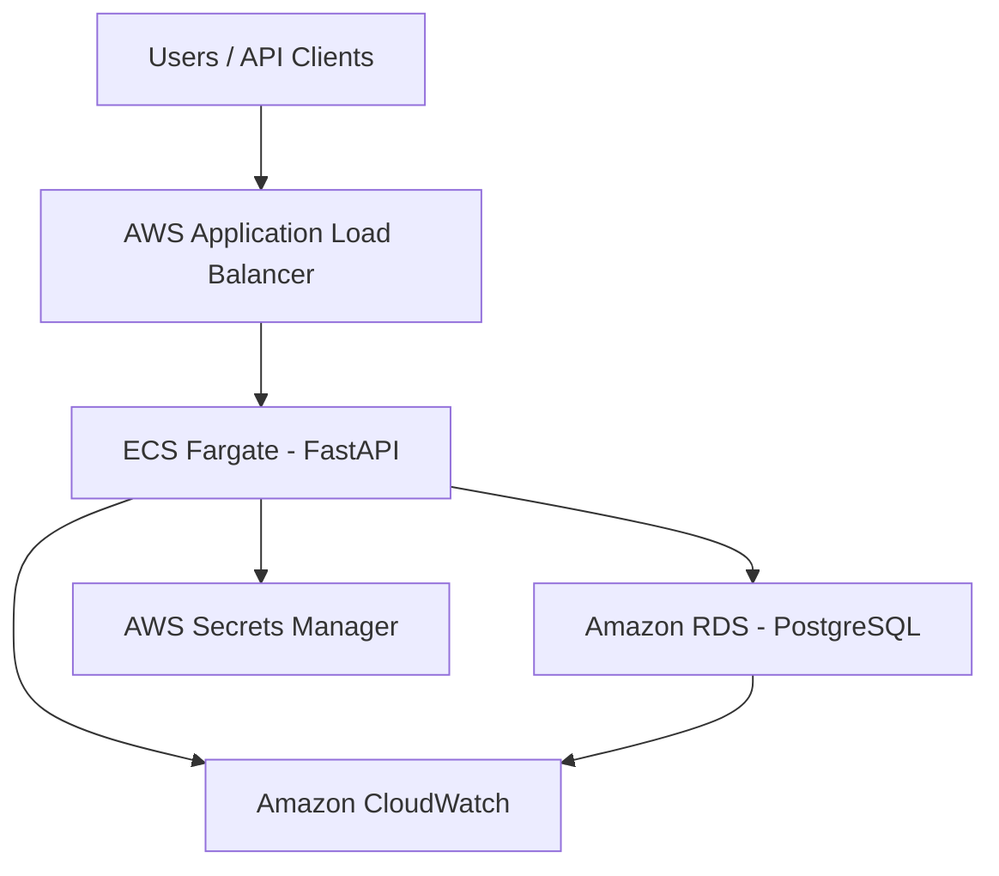
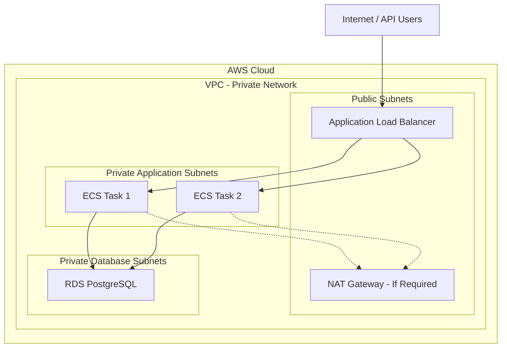
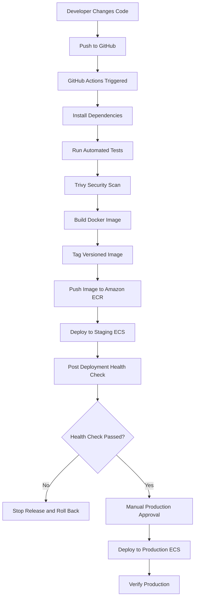
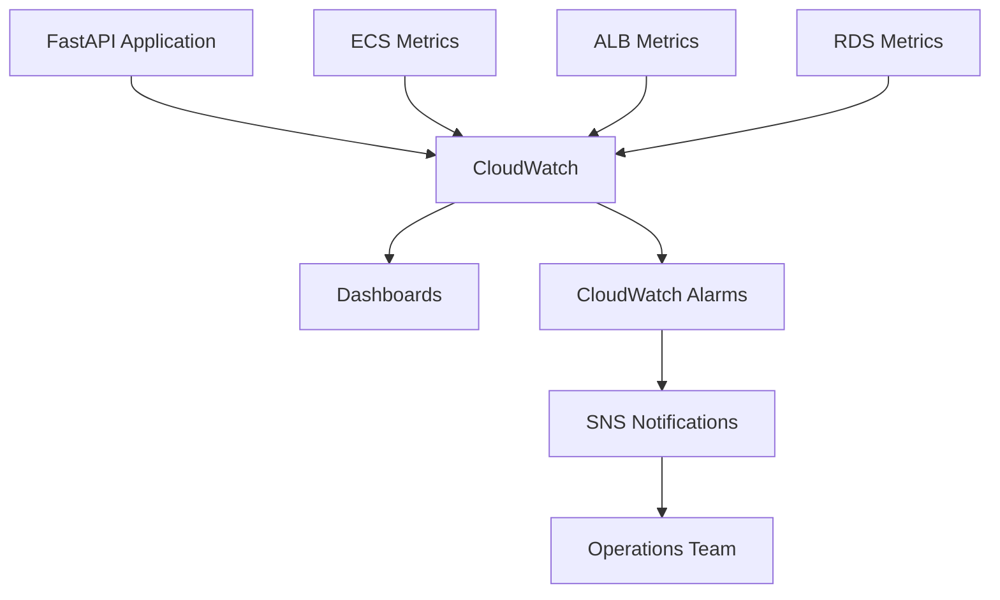
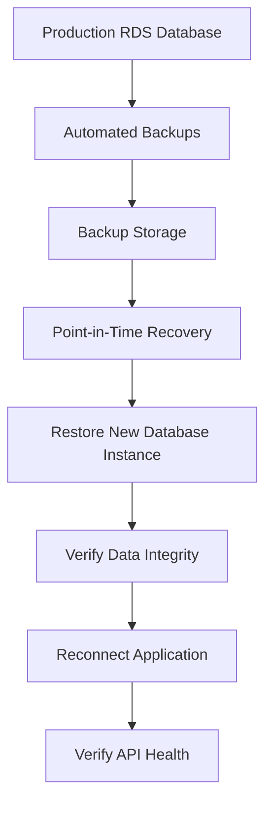

# Sessions Service – DevOps Deployment Project

## 1. Project Overview

This project demonstrates the design and implementation of a secure, scalable, and automated deployment setup for a containerised Sessions API.

The main focus is infrastructure automation, containerisation, CI/CD, security, monitoring, logging, and disaster recovery rather than complex application development.

## 2. Project Objectives

- Develop a small Sessions REST API.
- Containerise the API and PostgreSQL database.
- Configure a local development environment using Docker Compose.
- Provision cloud infrastructure using Terraform.
- Automate testing, image building, security scanning, and deployment.
- Implement secure secrets management and access control.
- Configure centralised logging, monitoring, and alerts.
- Document backup, recovery, and deployment rollback procedures.

## 3. Technology Stack and Tool Selection

| Category | Technology | Purpose |
|---|---|---|
| Application | Python + FastAPI | Develop REST API |
| Database | PostgreSQL | Store session data |
| Containerisation | Docker | Package application |
| Local environment | Docker Compose | Run API and database locally |
| Cloud provider | AWS | Cloud infrastructure |
| Container runtime | ECS Fargate | Run application containers |
| Container registry | Amazon ECR | Store Docker images |
| Database hosting | Amazon RDS | Managed PostgreSQL |
| Infrastructure as Code | Terraform | Provision infrastructure |
| CI/CD | GitHub Actions | Automate build and deployment |
| Security scanning | Trivy | Scan vulnerabilities |
| Monitoring | Amazon CloudWatch | Logs, metrics, and alerts |
| Secrets management | AWS Secrets Manager | Secure credentials |
| Version control | Git + GitHub | Track and manage code |

### Why these technologies?

**FastAPI:** Lightweight Python framework with automatic API documentation.

**PostgreSQL:** Reliable relational database with strong Docker and AWS integration.

**Docker:** Packages the application and dependencies into portable containers.

**Docker Compose:** Runs multiple containers together for local development and testing.

**AWS ECS Fargate:** Runs containers without requiring us to manage underlying servers.

**Terraform:** Defines reusable infrastructure configuration and supports repeatable deployments.

**GitHub Actions:** Integrates directly with GitHub and automates testing, building, scanning, and deployment.

**Trivy:** Identifies vulnerabilities in container images and dependencies.

**CloudWatch:** Centralises logs, metrics, dashboards, and alarms.

**AWS Secrets Manager:** Stores sensitive credentials securely and supports rotation.

### Alternative Tools Considered

**Jenkins vs GitHub Actions**

Both support CI/CD automation. GitHub Actions was selected because it integrates directly with GitHub and does not require maintaining a separate Jenkins server.

**Why not Ansible?**

Ansible is useful for configuring servers and operating systems. Since we use ECS Fargate, AWS manages the underlying infrastructure. Terraform handles infrastructure provisioning, so Ansible is not required.

**Why not Kubernetes / EKS?**

Kubernetes provides advanced container orchestration but adds operational complexity. ECS Fargate is sufficient for this small service and requires less infrastructure management.

## 4. High-Level Architecture

The application follows a containerised, cloud-based architecture.

### Runtime Architecture



### Request Flow

1. A user sends an HTTP request over HTTPS.
2. The Application Load Balancer receives the request.
3. The load balancer forwards traffic to a healthy ECS application container.
4. FastAPI validates and processes the request.
5. The application communicates with PostgreSQL.
6. PostgreSQL stores or retrieves the requested data.
7. The API returns a response to the user.
8. Application and infrastructure logs and metrics are collected in CloudWatch.

The database is not directly accessible from the public internet.

## 5. AWS Infrastructure and Network Design

### VPC Architecture

The application will run inside an AWS Virtual Private Cloud (VPC).

The network will be divided into public and private subnets across two Availability Zones.



### Network Boundaries

**Public Subnets**
- Application Load Balancer.
- NAT Gateway, if required.

**Private Application Subnets**
- ECS Fargate application containers.
- No direct public access to application tasks.

**Private Database Subnets**
- Amazon RDS PostgreSQL.
- No public IP address.
- Accepts connections only from the application security group.

### Security Group Rules

| Resource | Allowed Traffic |
|---|---|
| ALB | Internet to port 443 |
| ECS | ALB security group to port 8000 |
| RDS | ECS security group to port 5432 |

Only required network communication is permitted.

### Supporting AWS Services

**Amazon ECR:** Stores versioned Docker images such as `sessions-api:v1` and `sessions-api:v2`.

**AWS Secrets Manager:** Stores database credentials securely.

**AWS Certificate Manager:** Provides TLS certificates for HTTPS connections at the load balancer.

**AWS IAM:** Controls permissions for ECS tasks and deployment automation.

## 6. Application Architecture

The Sessions API will initially provide these endpoints:

| Method | Endpoint | Purpose |
|---|---|---|
| GET | `/health` | Health check |
| GET | `/sessions` | Retrieve sessions |
| POST | `/sessions` | Create a session |

The application will use FastAPI and PostgreSQL.

The API and database will run in separate containers during local development.

## 7. CI/CD Pipeline Architecture

GitHub Actions will automate the application release process.

### CI/CD Workflow



### Pipeline Stages

1. Developer pushes code to GitHub.
2. GitHub Actions starts automatically.
3. Dependencies are installed.
4. Automated application tests run.
5. Trivy scans for vulnerabilities.
6. Docker image is built and versioned.
7. Image is pushed to Amazon ECR.
8. Staging ECS service is updated.
9. Post-deployment health checks run.
10. Production deployment requires manual approval.
11. Production is deployed and verified.

### Secure CI/CD Authentication

GitHub Actions will use OpenID Connect (OIDC) to obtain temporary AWS credentials through an IAM role.

Long-lived AWS access keys will not be stored in the repository.

### Rollback Strategy

If deployment causes failures:

1. Detect failed health checks or increased 5xx errors.
2. Stop the faulty release.
3. Restore the previous known-good container image.
4. Verify application health.
5. Investigate the failed release.

## 8. Environment Separation

The project will use three environments.

### Development

- Runs locally on a developer's Mac.
- Uses Docker and Docker Compose.
- Uses a local PostgreSQL database.
- Used for development and testing.

### Staging

- Runs on AWS ECS Fargate.
- Uses a separate staging configuration and database.
- Used to validate releases before production.

### Production

- Runs on a separate ECS service.
- Uses production-specific database credentials.
- Uses separate secrets and configuration.
- Serves real application traffic.

Staging and production will not share credentials or application secrets.

## 9. Security Architecture

Security will be applied across all components.

| Area | Security Control |
|---|---|
| Network | VPC and security groups |
| HTTPS | ALB and AWS Certificate Manager |
| Application access | IAM task roles |
| Database | Private subnets |
| Credentials | AWS Secrets Manager |
| CI/CD authentication | GitHub OIDC |
| Image security | Trivy |
| Source control | GitHub repository protections |
| Logging | CloudWatch |

### IAM Roles

Two important ECS roles will be configured:

- **Task execution role:** Allows ECS to pull images from ECR, retrieve startup secrets where configured, and publish logs.
- **Task role:** Gives the running application only the permissions it needs.

The principle of least privilege will be followed.

### Secret Rotation

If a secret is exposed:

1. Revoke or disable the compromised credential.
2. Generate a replacement.
3. Update AWS Secrets Manager.
4. Update affected application connections.
5. Verify the service.
6. Investigate the exposure and review repository history.

## 10. Monitoring and Logging Architecture

Amazon CloudWatch will be used for centralised monitoring.

### Monitoring Flow



### Metrics to Monitor

- HTTP 5xx errors.
- ECS CPU utilisation.
- ECS memory utilisation.
- Request count.
- Database connections.
- Database CPU utilisation.
- Database storage capacity.

### Planned Alerts

**Alert 1: High 5xx Errors**

Trigger an alert when the load balancer's 5xx errors exceed an agreed threshold.

**Alert 2: High CPU Utilisation**

Trigger an alert when ECS CPU utilisation remains above 80% for five minutes.

Alerts will be delivered through Amazon SNS.

## 11. Backup and Disaster Recovery

Amazon RDS automated backups will be configured for the production database.

### Database Recovery Flow



### Recovery Procedure

1. Identify and investigate database failure.
2. Determine the latest suitable backup or recovery point.
3. Restore the database.
4. Verify tables, records, and data integrity.
5. Update application database connectivity if necessary.
6. Test application endpoints.
7. Resume normal operations.

### Recovery Objectives

**RPO (Recovery Point Objective):** The maximum acceptable amount of data loss measured in time.

**RTO (Recovery Time Objective):** The maximum acceptable time to restore service.

Specific RPO and RTO targets will be defined and tested as part of the recovery exercise.

## 12. Operational Incident Scenarios

### Scenario 1: Deployment Secret Exposed

- Revoke the exposed secret immediately.
- Rotate the affected credentials.
- Remove the secret from repository files and Git history where appropriate.
- Update Secrets Manager.
- Verify the application.
- Investigate the incident and prevent recurrence.

### Scenario 2: Sudden Traffic Increase

- Check ALB request count and response latency.
- Check ECS CPU and memory utilisation.
- Check database CPU and connections.
- Scale ECS tasks using service autoscaling.
- Assess whether database scaling is required.
- Review cost impact from additional tasks, database resources, NAT, and data transfer.

### Scenario 3: Database Unavailable

- Check RDS status and CloudWatch metrics.
- Investigate connectivity and database errors.
- Check recent database changes.
- Restore from a suitable backup if necessary.
- Verify database integrity.
- Reconnect the application.
- Verify application health.

## 13. Project Directory Structure

```text
Ahoum-Company-Assignment/
│
├── app/
│   ├── main.py
│   └── database.py
│
├── tests/
│   └── test_api.py
│
├── docker/
│   └── Dockerfile
│
├── terraform/
│   ├── modules/
│   └── environments/
│
├── docs/
│   ├── architecture.md
│   ├── deployment.md
│   ├── rollback.md
│   ├── secret-rotation.md
│   └── database-recovery.md
│
├── .github/
│   └── workflows/
│
├── docker-compose.yml
├── .gitignore
└── README.md
```

## 14. Cost Considerations

No paid AWS resources will be created solely for this assessment.

The project will prioritise:
- Local Docker demonstrations.
- Terraform configuration and plan output.
- Documented cloud deployment steps.
- Redacted pipeline and monitoring evidence.

Any cloud deployment will be optional and subject to cost review.

## 15. Project Status

- [x] Initial project structure created.
- [x] Development tools installed.
- [x] Technology stack selected.
- [x] High-level architecture designed.
- [ ] FastAPI application development.
- [ ] PostgreSQL integration.
- [ ] Docker implementation.
- [ ] Docker Compose setup.
- [ ] Automated tests.
- [ ] GitHub repository setup.
- [ ] GitHub Actions pipeline.
- [ ] Terraform infrastructure.
- [ ] Security implementation.
- [ ] Monitoring and alerting.
- [ ] Backup and recovery documentation.
- [ ] Final testing and evidence.
