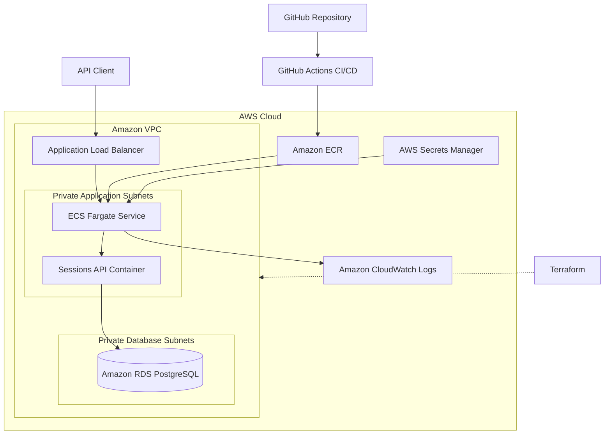

# Sessions API – System Architecture

## 1. Overview

The Sessions API is a containerised backend service designed to run locally using Docker Compose and to have a documented deployment path to AWS.

The proposed cloud architecture uses:
- Amazon VPC for network isolation.
- Application Load Balancer (ALB) for incoming HTTP/HTTPS traffic.
- Amazon ECS with AWS Fargate for running API containers.
- Amazon ECR for storing Docker images.
- Amazon RDS PostgreSQL for persistent database storage.
- AWS Secrets Manager for database credentials.
- Amazon CloudWatch for application logs and monitoring.
- Terraform for infrastructure provisioning.
- GitHub Actions for CI/CD automation.

**Important:** The AWS infrastructure is defined in Terraform and has been validated using `terraform plan`. It has not been deployed. Local application functionality and the CI pipeline have been tested.

## 2. Architecture Diagram

## 3. Network Design

The proposed AWS network uses a VPC with CIDR range `10.0.0.0/16`.

It contains six subnets distributed across two Availability Zones:

- Two public subnets for the Application Load Balancer.
- Two private application subnets for ECS tasks.
- Two private database subnets for RDS.

The public load balancer receives external traffic. ECS tasks and database instances remain in private subnets.

Security groups restrict communication:
- ALB accepts HTTPS traffic on port 443 and staging traffic on port 8443.
- ECS accepts application traffic on port 8000 only from the ALB security group.
- RDS accepts PostgreSQL traffic on port 5432 only from the ECS security group.

## 4. Application Environments

The design separates staging and production configurations.

- **Development:** Runs locally using Docker Compose with the API and PostgreSQL containers.
- **Staging:** Uses a dedicated ECS service and database configuration for testing releases.
- **Production:** Uses a separate ECS service and database configuration for live workloads.

Environment-specific settings and database credentials are supplied through configuration and AWS Secrets Manager rather than being hardcoded into application code.

## 5. Deployment and Traffic Flow

1. A developer pushes code to the GitHub repository.
2. GitHub Actions runs automated tests.
3. The Docker image is built and scanned for vulnerabilities.
4. When AWS deployment is enabled and configured, the image is pushed to Amazon ECR.
5. The staging ECS service receives the new image.
6. A health check verifies the deployment.
7. Production deployment requires a controlled approval step.
8. CloudWatch collects application logs.

## 6. Security Design

- Private subnets protect application and database workloads from direct public access.
- Security groups restrict traffic between components.
- IAM roles provide service-specific permissions.
- AWS Secrets Manager stores database credentials.
- HTTPS is configured at the load balancer using AWS Certificate Manager.
- Container images are scanned for known vulnerabilities.
- GitHub Actions is designed to authenticate to AWS using OIDC.

## 7. Infrastructure Deployment Status

Terraform configuration has been formatted and validated successfully.

The Terraform plan reports 46 resources to add. No Terraform apply has been performed, so no AWS resources have been created for this assessment.

The local Docker Compose setup and GitHub Actions CI pipeline have been tested successfully.

This approach demonstrates the intended cloud architecture without creating paid AWS resources solely for the assignment.